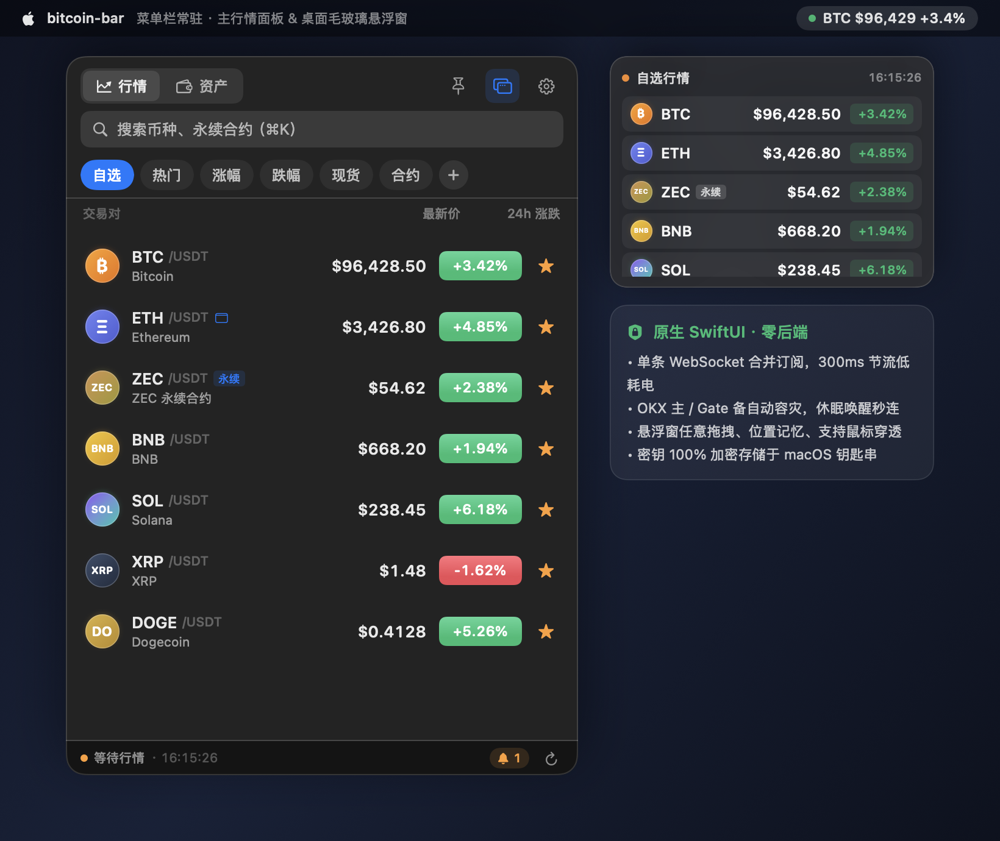
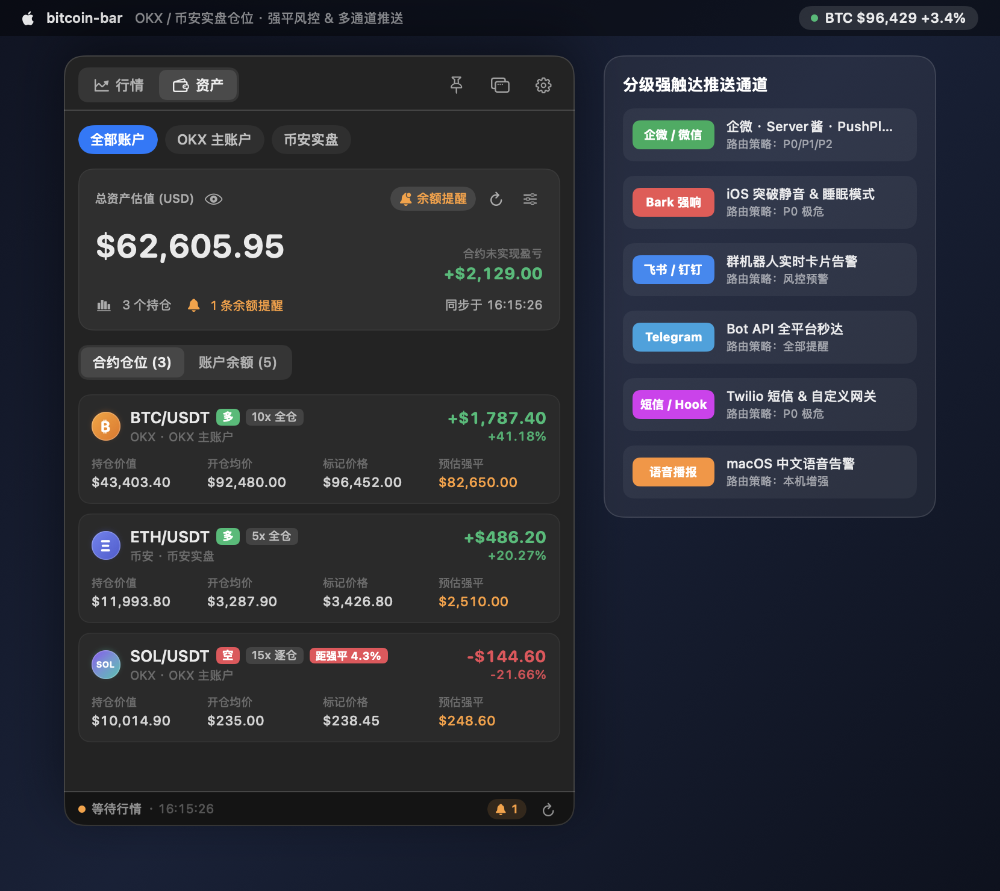
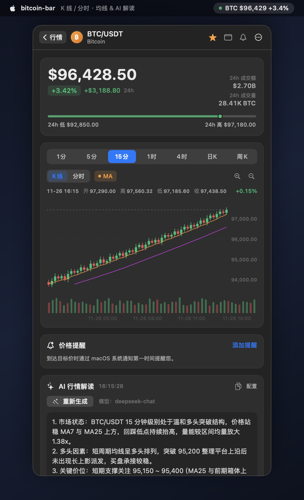
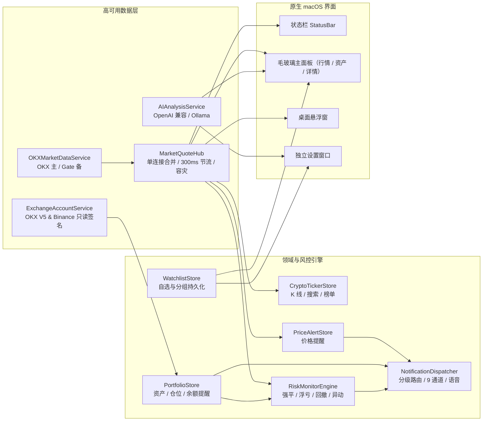

<div align="center">

# ₿ bitcoin-bar

**轻量、原生、开源的 macOS 菜单栏加密行情、实盘仓位与风控助手**

[](https://www.apple.com/macos/)
[](https://swift.org/)
[](./SECURITY.md)
[](./LICENSE)

*抬眼看菜单栏报价，轻点看 K 线与仓位，半夜距强平自动响铃叫醒你。*  
*零后端服务器 · 密钥本地钥匙串加密 · 全量代码透明可审计*

</div>

---

## 界面预览

<p align="center">
  
</p>

<details open>
<summary><b>查看更多界面（OKX / 币安实盘仓位风控 · 专业 K 线 & AI 行情解读）</b></summary>
<br/>
<p align="center">
  
</p>
<p align="center">
  
</p>
</details>

---

## 为什么做 bitcoin-bar？

盯盘和看仓位，本来不该这么折腾：

- **不想频繁切浏览器**：写代码、开会、看文档时，只希望在菜单栏或桌面角落安静看一眼价格和仓位盈亏；
- **不敢把 API Key 交给闭源软件**：交易所只读 API 涉及个人资产隐私，只有**完全开源、零中转、本地直连**才让人真正放心；
- **怕半夜插针爆仓叫不醒**：普通弹窗锁屏即失灵，真正需要的是**强平距离、浮亏、回撤实时巡检 + 微信 / Bark 突破静音强叫醒**。

`bitcoin-bar` 基于原生 **SwiftUI + AppKit + Swift Charts** 构建，无 Electron 内存开销，只做一件纯粹的事：**成为你 Mac 上最安心、最顺手的加密行情与风控终端**。

---

## 核心特性

### 1. 原生菜单栏 + 消费级主行情面板
- **菜单栏常驻**：默认隐藏 Dock 图标（可在设置开启），自定义显示样式（币种 + 价格 + 涨跌幅 / 精简 / 仅图标）、涨跌着色与紧凑缩写；菜单栏绑定币种固定不漂移。
- **即点即开，失焦即收**：点击菜单栏图标在正下方呼出毛玻璃卡片，支持顶部**图钉固定**；支持红涨绿跌（中式）与绿涨红跌（国际）自由切换。
- **全市场覆盖与分组**：内置 `自选 / 热门 / 涨幅 / 跌幅 / 现货 / 合约` 与持久化**自定义分组**；支持 `⌘K` 全局秒搜现货与永续合约、列排序、**自选拖拽排序**与价格跳动微闪烁。

### 2. 专业级交互式图表与详情页
- **双视图切换**：支持 **K 线蜡烛图** 与 **分时面积图** 一键切换，支持 `1分 / 5分 / 15分 / 1时 / 4时 / 日K / 周K` 7 个周期。
- **技术辅助**：内置 **MA7 / MA25 均线**开关、完整 X/Y 轴刻度、底部成交量副图、**鼠标悬停十字光标 OHLCV 信息条**、拖动平移与双指缩放，以及 **24h 价格区间进度条**。

### 3. 精致桌面悬浮窗（看盘 / 摸鱼神器）
- **高对比度深色毛玻璃**：透明度滑块仅调节背景通透度，**文字与价格始终清晰锐利**。
- **任意位置拖拽与位置记忆**：按住悬浮窗任意位置即可自由拖动，轻点币种直接跳主面板 K 线详情，重启后自动恢复原位。
- **鼠标穿透模式**：右键一键开启点击穿透，完全不遮挡下方工作窗口（菜单栏右键可随时关闭穿透）。

### 4. OKX & 币安只读账户：实盘仓位与余额总览
- **多账户汇总**：同时接通多个 **OKX（V5，支持实盘与模拟盘）** 与 **币安 Binance（现货 + U 本位永续）** 只读账户，汇总总净值（USD）与合约未实现总盈亏。
- **专业仓位卡片**：展示多/空方向、杠杆倍数、全仓/逐仓、开仓均价、标记价格、预估强平价、ROE 收益率与**强平安全距离警示徽章**；**点击仓位卡片直达对应合约 K 线页**。
- **一键防窥隐私模式**：点击眼睛图标瞬间将所有金额与盈亏脱敏为 `****`。

### 5. 主动风控预警 + 9 大强触达推送通道
不只是被动等目标价，更为实盘持仓提供全天候主动守护：

- **主动风控引擎**：
  - **强平距离预警（P0 极危 / P1 预警）**：自动监测 `|标记价 - 强平价| ÷ 标记价`，提前在爆仓前报警；
  - **单仓浮亏 / ROE 预警（P1）**：单仓亏损比例或金额超阈值立即提示；
  - **账户当日净值回撤预警（P0 极危）**：自动追踪今日权益高点，回撤达阈值触发风控；
  - **短时剧烈异动 / 插针提醒（P1）**：自选与持仓币种在 3 / 5 / 15 分钟内剧烈波动自动报警；
  - **自定义价格提醒 & 账户余额提醒**：监控币种突破/跌破目标价，以及总资产或指定币种（如 USDT 保证金）余额阈值。
- **多通道分级强触达**：
  - **微信**：企业微信群机器人（免费不限量）、Server酱（兼容 Turbo & Server3）、PushPlus；
  - **iPhone 强叫醒**：**Bark**（P0 极危自动附带 `level=critical&call=1`，**突破静音与睡眠专注模式强响**）；
  - **团队 / 跨平台**：飞书机器人、钉钉机器人、Telegram Bot；
  - **短信 / 网关**：Twilio 短信直发、自定义 Webhook（POST JSON，可对接个人短信/电话告警网关）；
  - **macOS 本机增强**：原生通知横幅 + 分级提示音 + **中文语音播报（AVSpeechSynthesizer）**。
  - 每个通道独立设置路由范围：`全部提醒 (P0/P1/P2)`、`仅风控 (P0/P1)` 或 `仅极危 (P0)`，内置冷却防刷屏与送达日志。

### 6. AI 深度行情解读（BYOK）
- 基于当前币种 24h 行情、预计算的 `MA7 / MA25` 与量能摘要、以及最近 60 根 K 线，生成不截断的结构化中文分析（市场状态、多空因素、关键支撑/压力位、突破/回踩/跌破情景推演与风险提示）。
- 内置 **OpenAI、DeepSeek、通义千问、Kimi（Moonshot）、本机 Ollama（数据完全不出本机）** 及自定义 OpenAI 兼容预设，支持一键测试连接与结果缓存。

### 7. 工业级行情连接稳定性
- **全局单连接中枢**：菜单栏、悬浮窗、列表、详情与风控引擎合并去重，仅维护一条 WebSocket，300ms 批量节流刷 UI 兼顾丝滑与省电。
- **多重容灾**：15s 心跳 + 无消息看门狗、指数退避重连、OKX 不可达自动切换 Gate.io 备用源、REST 批量轮询兜底，并监听 `NWPathMonitor` 网络切换与系统休眠唤醒自动恢复。

---

## 安全与隐私架构

> 详见 [SECURITY.md](./SECURITY.md)

| 项目 | 实现方式 |
| --- | --- |
| 后端服务器 | **无**（零中转、零埋点、零统计） |
| 交易所 / AI / 推送密钥 | 100% 加密存储于本机 **macOS 钥匙串（Keychain）** |
| 交易所接口权限 | 仅使用 **只读（Read-Only）** 接口，代码不含任何下单或提币逻辑 |
| 网络沙箱 | 启用 macOS App Sandbox，仅声明 `network.client` 出站权限 |

---

## 快速开始

### 环境要求
- **macOS 14.0 (Sonoma)** 或更高版本（同时支持 Apple Silicon 与 Intel）
- **Xcode 16+**（从源码编译需要）

### 方式一：下载预编译版本
前往本仓库的 **[Releases](https://github.com/YangPei1993/bitcoin-bar/releases)** 页面下载最新的 `bitcoin-bar-*-macOS.zip`，解压后将 `bitcoin-bar.app` 拖入「应用程序」文件夹即可。

> **首次打开提示说明**：若 Release 包采用本地临时签名（未经 Apple 公证），首次打开可能提示“无法验证开发者”。可在「系统设置 → 隐私与安全性」点击“仍要打开”，或在终端执行 `xattr -cr /Applications/bitcoin-bar.app`。

### 方式二：从源码一键编译运行

```bash
git clone https://github.com/YangPei1993/bitcoin-bar.git
cd bitcoin-bar
./script/build_and_run.sh
```

脚本会自动检测本机开发者证书；若未登录 Apple 开发者账号，将自动使用本地临时签名（Ad-hoc）完成编译并启动，零配置开箱体验。

也可以直接用 Xcode 打开 `bitcoin-bar.xcodeproj`，在 `Signing & Capabilities` 选择你的个人 Team（或 Sign to Run Locally）后按 `⌘R` 运行。

---

## 常用快捷键

| 快捷键 | 功能 |
| --- | --- |
| `⌘K` | 快速聚焦搜索全市场现货与永续合约 |
| `⌘,` | 打开独立设置中心（通用 / 显示 / 账户 / 风控提醒 / 推送通道 / AI 助手） |
| `⌘R` | 手动刷新实时行情或同步交易所账户资产 |
| `Esc` | 从详情页返回列表，或收起主行情面板 |

---

## 架构概览



---

## 路线图（Roadmap）

- [x] 原生菜单栏、毛玻璃主面板、交互式 K 线/分时图表与桌面悬浮窗
- [x] OKX V5 & 币安实盘只读账户净值、余额与合约仓位看板
- [x] 价格提醒、余额提醒与主动风控引擎（强平距离 / 浮亏 / 回撤 / 异动）
- [x] 微信 / Bark / 飞书 / 钉钉 / Telegram / Twilio 短信 / Webhook 分级强推送
- [x] AI 深度 K 线解读（6 大服务商 + 本地 Ollama）
- [ ] 支持更多交易所（Bybit / Bitget / Hyperliquid）
- [ ] 合约资金费率异常监控与 AI 持仓风控体检
- [ ] 支持多计价法币（CNY / EUR / HKD）切换与 Homebrew Cask 分发

---

## 参与贡献

欢迎通过 Issue 提交想法与 Bug 反馈，或直接发起 Pull Request！如果你觉得这个项目对你有帮助，欢迎点一个 **Star ⭐** 支持一下。

## 免责声明

本项目仅供行情浏览、个人资产看板与技术学习使用，所有行情数据与 AI 解读内容均**不构成任何投资或交易建议**。加密货币及衍生品波动剧烈，存在较高风险，请结合交易所官方客户端谨慎决策并严格控制仓位风险。

## 开源协议

本项目基于 [MIT License](./LICENSE) 开源。
